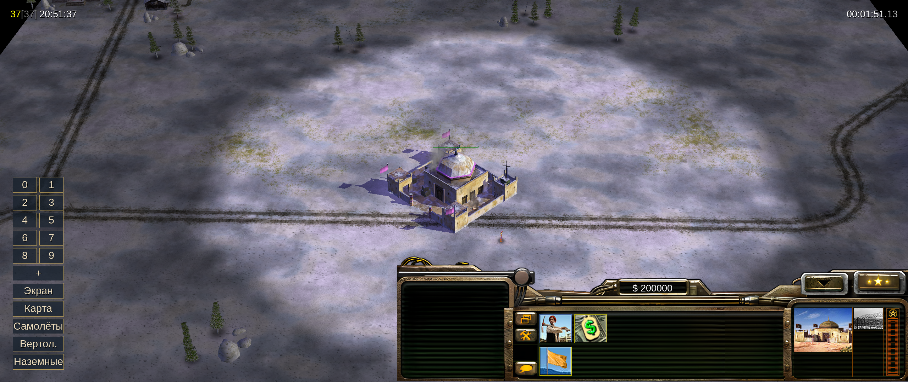
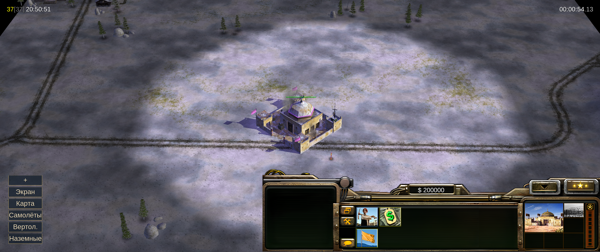
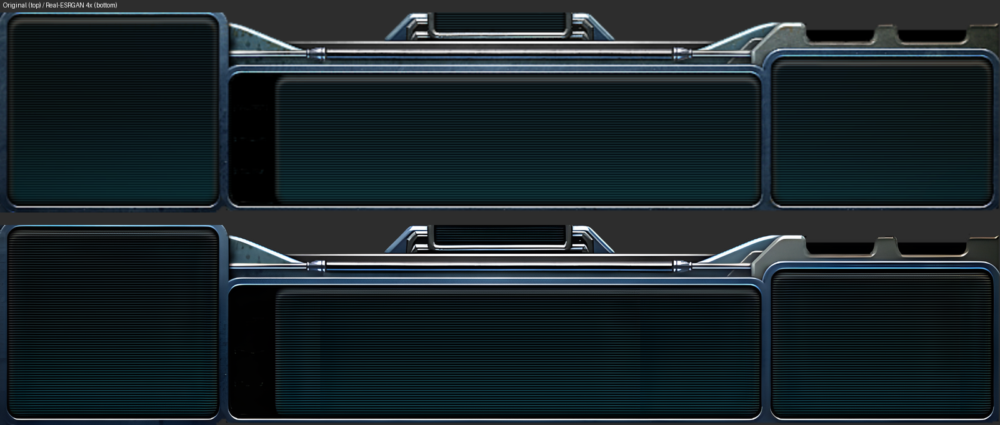
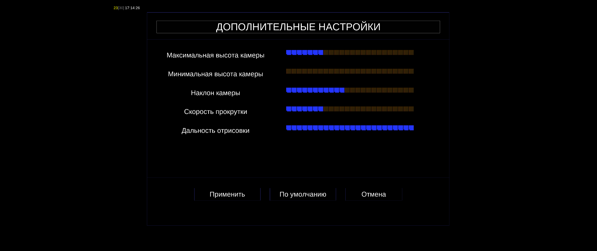
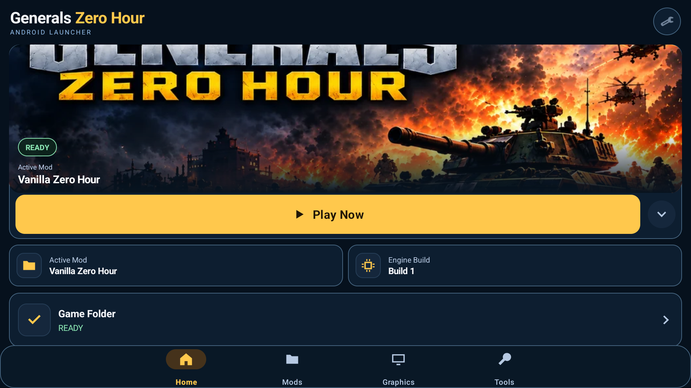
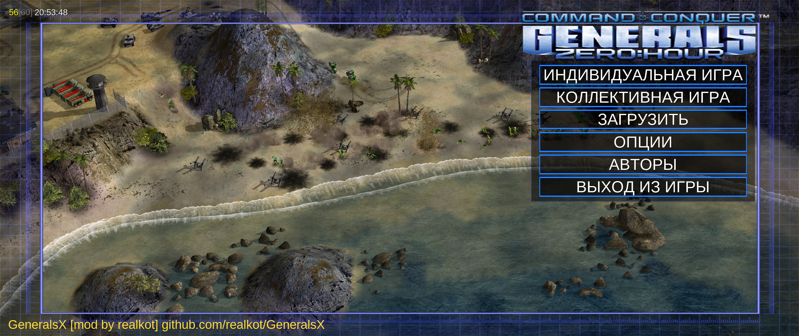

# GeneralsX [mod by realkot]

Android-порт **Command & Conquer: Generals Zero Hour** с доработками управления на планшете, интерфейса и удобства игры. Актуальная тестовая версия — **r9**.

**[Скачать APK r9](https://github.com/realkot/GeneralsX/releases/download/inputtest-20261015-r9/GeneralsZH-InputTest-20261015-r9.apk)** · [Все сборки и история изменений](https://github.com/realkot/GeneralsX/releases) · [Краткий changelog](CHANGELOG_RU.md) · [English changelog](CHANGELOG_EN.md)

Android 9+, ARM64. Отдельный пакет `com.generalsx.zerohour.inputtest`. Оригинальные данные установленной Zero Hour необходимо предоставить отдельно. Это неофициальная модификация, не связанная с Electronic Arts.

## Что изменилось относительно родительских проектов

Основа — [koreazolfakar-droid/GeneralsZH-Android-Port](https://github.com/koreazolfakar-droid/GeneralsZH-Android-Port) (`3793ab15`), с выборочными переносами из веток этого проекта и [MYSOREZ/GeneralsZH-Android-Port](https://github.com/MYSOREZ/GeneralsZH-Android-Port) (main `576e2265`). Перенесённые разработки сохраняют авторство; возможности исходного порта не считаются написанными здесь с нуля.

### Армия и группы

Пять кнопок находятся внизу слева, в свободной области рядом с панелью. Строители, добытчики и здания не включаются в боевую армию.

| Кнопка | Действие |
|---|---|
| Экран | Выделить боевые юниты на видимой части карты |
| Карта | Выделить боевые юниты на всей карте |
| Самолёты | Выделить боевые самолёты на всей карте |
| Вертол. | Выделить боевые вертолёты на всей карте, включая подходящие вооружённые транспорты |
| Наземные | Первое нажатие — наземная армия на экране; повторное — на всей карте |
| + | Показать/скрыть кнопки групп 0–9 над армейскими кнопками |

### Панель управления и её качество

Панель сохраняет исходные пропорции и прижата к правому краю; слева видна карта. Для США, Китая и ГЛА сохранены **шесть атласов панели, увеличенных в 4 раза** с помощью Real-ESRGAN. Прозрачность и координаты кнопок сохранены. Это улучшение панели, а не всей графики игры.

Сравнение текстуры панели США: сверху оригинал, снизу обработанный вариант из r7, сохранённый в r9. Это сравнение ресурса, а не два снимка боя.

### Мышь, клавиатура и приказы

- Физические ЛКМ/ПКМ работают через штатную схему игры; колесо меняет масштаб, удержание средней кнопки перемещает камеру, подведение к краю прокручивает карту.
- Расширены обработка клавиатуры, модификаторов и клавиш; горячие клавиши зависят от игровых данных. Физический курсор увеличен вдвое.
- Исправлены потеря событий мыши, первый приказ после выделения и координаты повторных быстрых кликов. Предпросмотр постройки следует за курсором без удержания ЛКМ.
- Обычное движение боевой группы использует **атаку в движении**. Взаимодействие с целью, специальные и принудительные команды сохраняют собственное поведение.

### Камера и Extras

Предел ручной высоты камеры — **3600**. Начальная камера и сценарные пролёты сохраняют свои настройки. Исправлены открытие, применение, отмена и возврат из Extras; кнопка размещена в свободном месте заголовка Options. Оформление согласовано с основными настройками, маленькие квадратные маркеры шкал убраны. Доступны высота/наклон камеры, скорость прокрутки и дальность отрисовки.

Снимок Extras из r8: показанное оформление сохранено в r9; графические эксперименты r8 в текущую версию не входят.

### Лаунчер, загрузка и совместимость

Выборочно перенесены менеджер модов, импорт и проверка данных, темы и локализация лаунчера, исправления сохранений/карт, командных страниц, аудио и сетевой безопасности. Убраны лишние перерисовки загрузки; исправлены подписи групп и масштабирование шрифтов пользовательских окон. Стартовый логотип EA пропускается. Изменены подписи проекта в меню и настройках.

Снимок лаунчера из r2 иллюстрирует перенесённый интерфейс; не является новым снимком r9.

## Что отменено в r9

Отменены массовый апскейл меню r8 (97 дополнительных игровых атласов и 14 изображений лаунчера), дополнительные изменения рендеринга/GLES/terrain/HLOD/shadow, AI/поиска пути/приоритета скриптов и раскрытия тумана попаданиями. Панель справа и её шесть HD-атласов сохранены. Графическая основа возвращена к выбранному main koreazolfakar-droid.

## Проверка и ограничения

Исходники отката прошли 47 Android-тестов и проверки реального кода ввода/интерфейса. Проверены пакет, подпись, ресурсы и оба движка; в MuMu — схватка ГЛА на «Одиноком орле (4)», панель, кнопки и запуск движка 60 Гц. Движки 30/60 Гц унаследованы от родительского проекта; это не гарантия 30/60 FPS.

Полоска GLES при высокой камере **не объявляется исправленной**. «Взлом спутников 2» не менялся. Проверка MuMu не заменяет тестирование физического планшета, всех модов и мультиплеера. Используйте разрешение с соотношением сторон экрана: иначе исходный рендерер может растянуть весь кадр. Перед заменой версии сохраните настройки и сохранения; установка старой версии поверх новой может быть отклонена Android.

## История сборок

Все 10 ранее собранных APK, включая r6 UI-control, опубликованы в [Releases](https://github.com/realkot/GeneralsX/releases) как тестовые версии с русскими/английскими примечаниями и SHA-256. Архивные версии публикуются без пересборки; **r8 — отменённый эксперимент**, для текущего тестирования выбирайте r9. Архивные теги ссылаются на снимок публикации r9, а не на точные старые деревья исходников.

## English overview

This unofficial Android Zero Hour modification adds tablet mouse/keyboard improvements, screen/map/air/ground army selectors, control-group buttons, a proportional right-aligned HUD with six retained 4x HD panel atlases, a 2x physical cursor, working Extras and a 3600 manual camera ceiling. Combat movement defaults to attack-move; contextual and forced orders retain their own behavior. Loading redraws, captions, build previews and mouse ordering were corrected. Selected launcher/mod/save/audio/network improvements come from the parent lineages.

**r9 reverts the broad r8 menu upscale and additional renderer/AI experiments while retaining the HUD work.** The high-camera GLES strip is not claimed fixed; Satellite Hack 2 is unchanged. See the [English changelog](CHANGELOG_EN.md) and bilingual [release notes](https://github.com/realkot/GeneralsX/releases). Screenshots are labeled by build; invisible input/performance changes cannot be proven by screenshots.

## Authors, source and local builds

Thanks to [koreazolfakar-droid](https://github.com/koreazolfakar-droid/GeneralsZH-Android-Port), [MYSOREZ](https://github.com/MYSOREZ/GeneralsZH-Android-Port), EA/Westwood/EA Pacific, [TheSuperHackers](https://github.com/TheSuperHackers/GeneralsGameCode), [Fighter19](https://github.com/Fighter19/CnC_Generals_Zero_Hour), [fbraz3](https://github.com/fbraz3/GeneralsX), [ammaarreshi](https://github.com/ammaarreshi/Generals-Mac-iOS-iPad), the [GeneralsOnline team](https://github.com/GeneralsOnlineDevelopmentTeam), and the SDL, DXVK, OpenAL, FFmpeg and other dependency authors. HUD reconstruction used [Real-ESRGAN](https://github.com/xinntao/Real-ESRGAN). Parent attribution remains in source history and comments.

Engine source: [GPL v3](LICENSE.md). Original game data is required separately; this repository does not grant rights to original game assets. This is not an official EA product.

Build locally with the preserved toolchain using `scripts/build/android/build-dual-hz.sh` and one unchanged source tree for both engines. For this test identity set `GX_INPUT_TEST=1`, `GX_ANDROID_VERSION_CODE=10309`, `GX_ANDROID_VERSION_NAME=1.4.0-inputtest.20261015-r9`, `GX_PRESERVE_BUILD_ENV=1`. See the [parent Android build guide](docs/port/ANDROID_PORT.md) for prerequisites and [r9 validation report](docs/WORKDIR/reports/ANDROID_INPUT_TEST_R9.md) for the actual test scope. Inherited guides may describe parent features absent from r9. CI builds are not launched for this publication.
