# GeneralsX [mod by realkot]

**Your familiar Generals Zero Hour, with controls tailored to an Android tablet.** Mouse and keyboard, quick army selection, a flexible camera and a HUD that leaves more room for the battle.

**[Download r12](https://github.com/realkot/GeneralsX/releases/tag/inputtest-20261017-r12)** · [All versions](https://github.com/realkot/GeneralsX/releases) · [Русский](README.md) · [Changelog](CHANGELOG_EN.md)

Android 9+ · ARM64 · separate package `com.generalsx.zerohour.inputtest`. **Original installed Zero Hour game data is required separately.** r12 is a test prerelease; main game code remains based on r9 until confirmed testing.

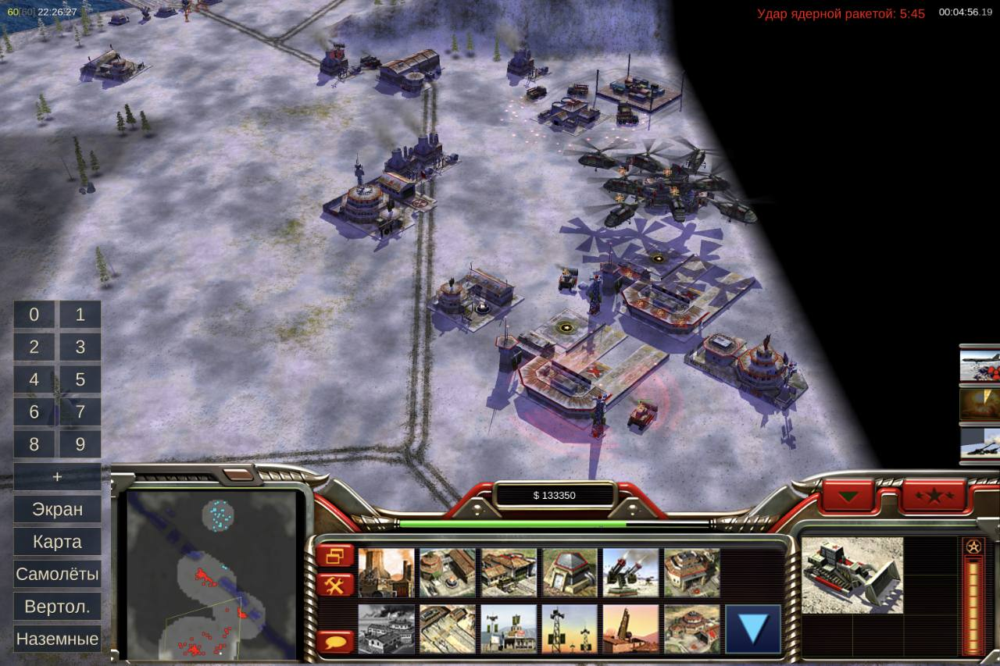

## Mod highlights

- **Mouse and keyboard.** Left/right buttons follow the game's mouse mode; wheel zoom and held middle-button camera movement, with fixes for event queues, construction previews and click detection. Standard hotkeys and modifiers. Individual peripherals still need device testing.
- **One-tap army selection.** Combat units on screen or across the map, plus separate aircraft and helicopter selectors. Ground army: first tap selects visible troops, the next selects map-wide. Builders, harvesters and structures are excluded.
- **Make the buttons yours.** Size, width, background, offsets, individual visibility and measured caption fitting. Plus opens groups 0–9; hold or right-click it to collapse the army column.
- **Orders and cursor.** Optional default attack-move while retaining forced normal movement. Physical cursor size 100–250%, with an optional contrast outline. A local order log helps investigate missed clicks.
- **See more of the battlefield.** Camera ceiling 3600, exact fields and +/- buttons, with 400/1000/2000/3600 presets. Extras follows the game's settings style; r11 fixes slider-to-field updates.
- **A HUD without stretching.** Original proportions, aligned right with visible map space on the left. Six USA, China and GLA HUD atlases retain their ×4 upscale. This is not a claim of upgraded graphics throughout the game.

## Tablet settings

Launcher → wrench → **Interface → Tablet controls**. Preferences save automatically; fully close and restart the game to apply them. Software-touchpad cursor size is configured separately from the physical cursor.

| Controls and cursor | Camera and Extras |
|---|---|
| 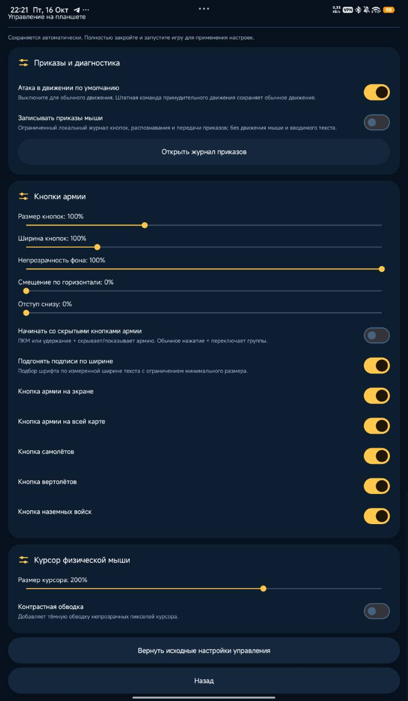 | 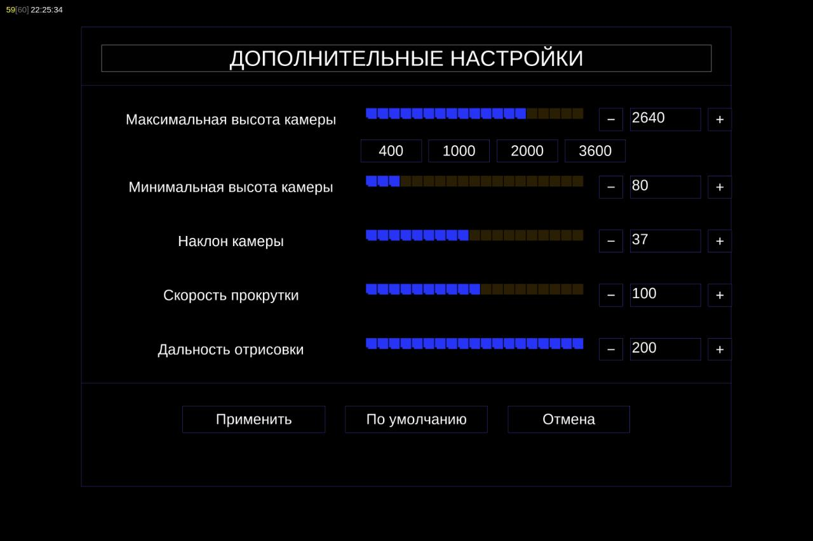 |

Launcher and game gallery

**Home**

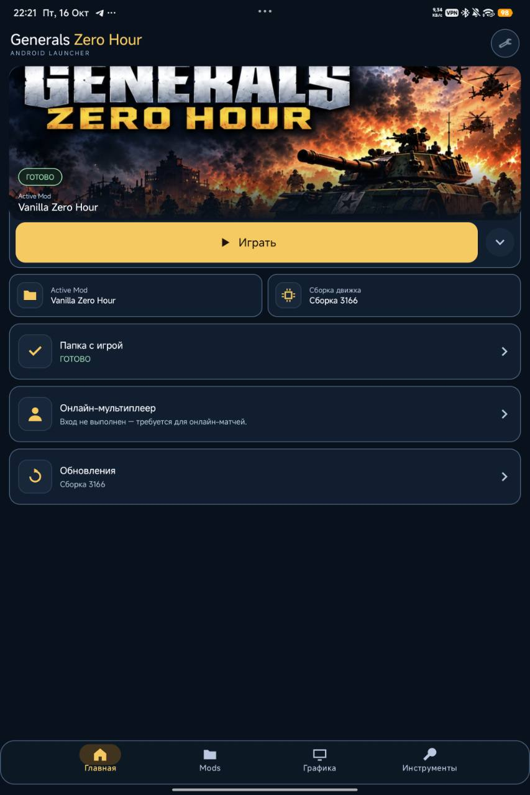

**Interface**

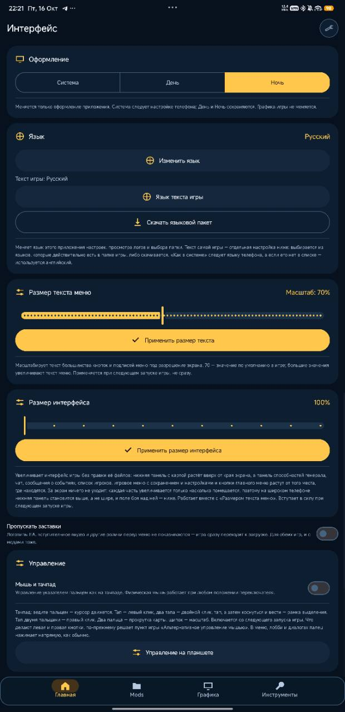

**Mods**

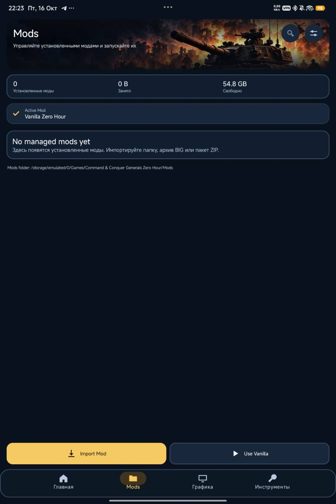

**Graphics**

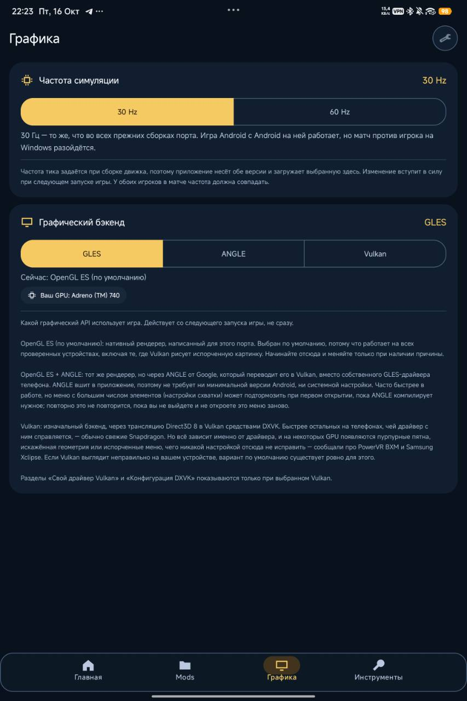

**Tools**

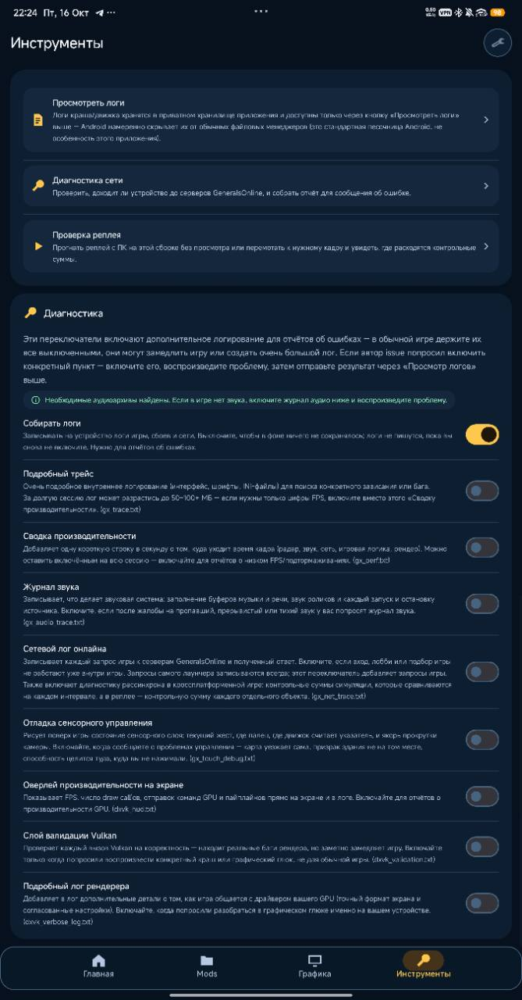

**Game main menu**

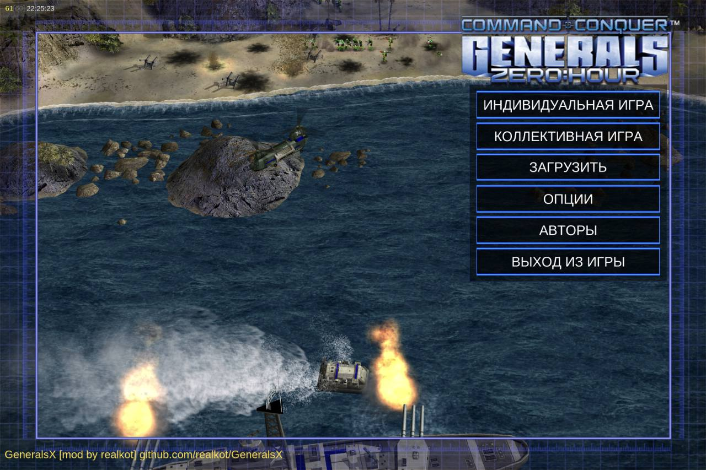

**Game options**

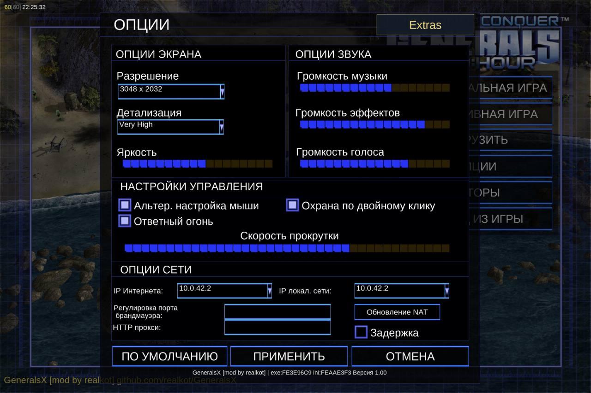

**Groups 0–9 with army buttons hidden**

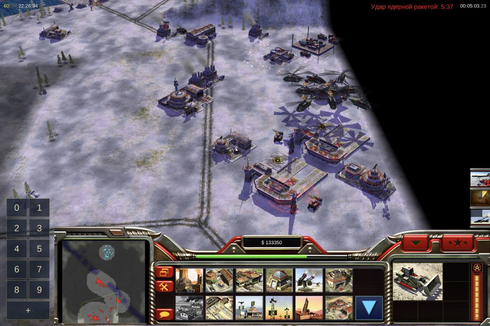

Screenshots supplied by the owner before launcher translation completion.

## Install and update

1. Download the APK from [Releases](https://github.com/realkot/GeneralsX/releases), install it and grant the required permissions.
2. Select your Zero Hour game-data folder in the launcher. The original game is not included in the APK.
3. Choose a graphics mode, UI scale and controls, then launch. Both 30/60 Hz engines are available; this is simulation frequency, not a promise of corresponding rendered FPS.
4. Install subsequent test APKs over the same package with the same signing identity. Back up important saves and settings before replacing versions. To downgrade test APKs without deleting data, use **ADB `install -r -d`** — [instructions and Windows helper](docs/HOWTO/TEST_APK_ROLLBACK.md). Android’s normal installer does not allow version downgrades.

**New in r12:** launcher update checks from this repository, stable/test channel selection, release notes and APK package, signature and SHA-256 verification. Installation requires user confirmation in Android. Language packs and the used Android resources are hosted in our repository; GeneralsOnline and official tools keep their existing sources. Russian mod-manager translation is completed.

## Status and attribution

Screenshots were supplied by the user from a tablet. Host/Android tests and a successful build do not replace gameplay testing on a specific device. The high-camera strip and Satellite Hack 2 behavior are not claimed fixed. Compatibility with every mod, peripheral or multiplayer setup is not guaranteed.

Based on [koreazolfakar-droid/GeneralsZH-Android-Port](https://github.com/koreazolfakar-droid/GeneralsZH-Android-Port), with selected changes from [MYSOREZ/GeneralsZH-Android-Port](https://github.com/MYSOREZ/GeneralsZH-Android-Port). The original port's SDL3, graphics backends, audio, video, mod system and online support were not written from scratch by realkot. Attribution and licenses are retained. An unofficial project, not affiliated with Electronic Arts.

[Detailed RU changelog](CHANGELOG_RU.md) · [EN](CHANGELOG_EN.md) · [Release and rollback policy](docs/HOWTO/RELEASE_POLICY.md)
