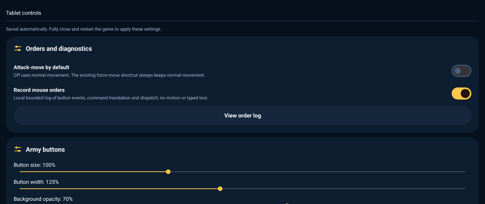
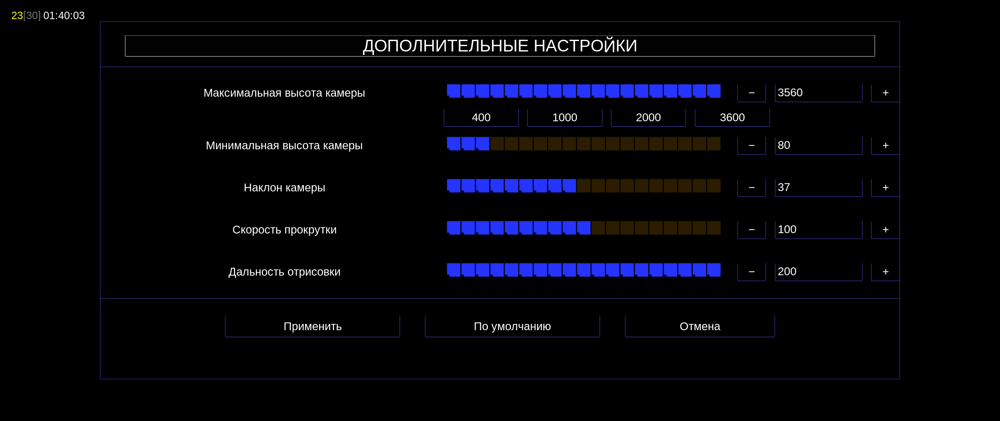
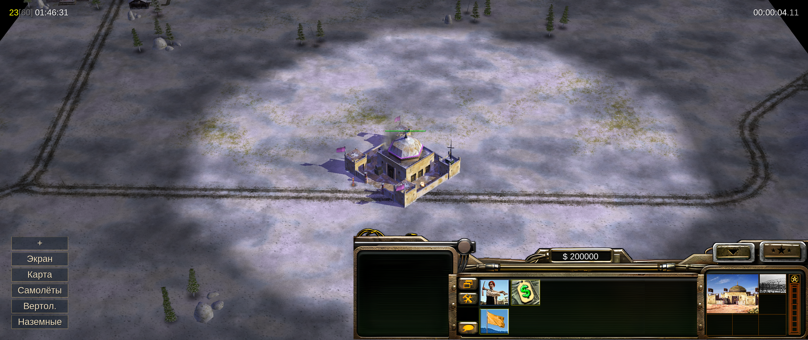

# Android tablet controls r10 candidate

Version: `1.4.1-inputtest.20261016-r10`, versionCode `10310`.
Package: `com.generalsx.zerohour.inputtest`.
Release branch: `release/1.4.1-inputtest-r10`. Owner acceptance: **pending**.
Main remains r9 (`9e372c9`) until explicit owner confirmation of this candidate.

## Scope

- Bilingual launcher tablet-control screen with atomic, bounded startup preferences.
- Opt-in local button/translation/click/order/dispatch tracing, wrapped at 512 KiB;
  no typed text or continuous pointer motion. View the private log from the launcher.
- Optional default attack-move; the existing force-move and contextual paths remain.
- Army button scale, width, background opacity, offsets, individual visibility,
  startup collapse and measured caption fitting. Normal plus tap toggles groups;
  right-click or a long press on plus toggles the army column.
- Physical cursor 100–250 percent, consistent hotspot and optional contrast outline.
  The existing software-touchpad cursor remains separate.
- Extras exact numeric fields, +/- steps and 400/1000/2000/3600 camera presets.
  Existing camera storage quantizes manual maximum height to multiples of four.
- Reject unmatched physical releases after focus/device/gesture cancellation.

Close the game process completely before applying changed launcher settings.
The right-aligned HUD, six HD panel atlases, renderer/AI rollback and 3600 ceiling
remain. The high-camera strip and Satellite Hack 2 are outside this iteration.

## Feature rollback

Runtime rollback: turn off diagnostics, attack-move, caption fitting and outline
individually; restore panel defaults or set cursor to 200 percent. Reset restores
the candidate's baseline preferences without clearing game data.

Source rollback: revert feature commits in a new branch, preserving published
history. Use the matching regression changes and rerun tests. Shared preference
and trace interfaces are dependencies: retain those interfaces if later features
still call them; do not delete shared headers while reverting only their hooks.

| Change | Primary commit(s) |
|---|---|
| Shared preference contract and release policy | `83deaf5` |
| Launcher screen and persistence | `8bb9f96` |
| Diagnostic hooks, private path and game-thread focus | `7967057`, `0a8440b`, `38b7420` |
| Default attack-move setting | `7f68f45` |
| Physical cursor | `2a150ad` |
| Army panel and preserved colors | `1e9d144`, `0bed112` |
| Exact Extras controls | `394dfe6` |
| Orphan-release handling and bounded button IDs | `5023023`, `842ca7f` |

Every delivered replacement APK must receive a higher versionCode and a fresh tag;
an older release remains available for recovery but Android may reject a downgrade.

## Validation

- Both native engines built locally using the official dual-Hz script, from the same native source through `38b7420`. The later test/document commits do not alter packaged code. No toolchain or cache cleanup.
- 176 changed source/resource files compared with the persistent build tree: exact binary match, LF-normalized text match.
- Host production-code regressions passed, including input queues/click tolerance, orphan/invalid releases, lifecycle thread boundary, attack-move on/off, selection, Extras exact values, cursor hotspots/outline, preferences, trace opt-in/wrapping and HUD/layout/font checks.
- 49 Android Robolectric tests: zero failures, errors or skips. Covers preferences, corrupt input, reset, Activity launch and non-exported registration; earlier launcher suites also passed.
- APK verification passed: test identity/code/name, matching existing signing certificate, ZIP CRC, alignment, ARM64 dependencies, JNI, distinct 30/60 Hz engines, shipped WND, unchanged six HD HUD atlases and 14 launcher rasters.
- MuMu final-APK visual checks at 2560×1080: 30 Hz main menu and Lone Eagle (4) GLA skirmish; readable Russian army labels, right HUD, plus/group controls and long-hold collapse. Extras preset 3600 then minus gives 3560; cancel returns to Options. Earlier identical Extras source was also checked with typed 803 → 800 and persisted maximum 200 nominal (800 manual).
- 60 Hz main menu and GLA skirmish visually checked; SDL log confirms loading `libmain60.so` (not a claim of 60 rendered FPS). New launcher controls and private trace viewer opened on the final APK. Original MuMu settings were restored byte-for-byte and temporary QA controls/language data archived outside the app; installed APK hash matches the release.
- Final-APK focus-loss trace shows cancellation, then focus gained and the battle resumes. No unmatched physical release accepted in production host tests. MuMu synthetic mouse taps report invalid SDL button 0 and are discarded; these do not establish Logitech click behavior.

Artifact: `GeneralsZH-InputTest-20261016-r10.apk`, 87,157,508 bytes. SHA-256:
`6679950d40b678244a639da8b41ef630488bbdcc240709c3b4b9271a438aec37`.

Emulator/host tests do not establish Logitech/tablet hardware behavior, performance,
all mods or multiplayer compatibility. The physical cursor appearance must be
confirmed with an actual mouse. No owner acceptance is inferred from tests.

## Owner test checklist

1. Install r10 over the same test package. Open launcher wrench → Interface → Tablet controls (Russian: «Управление на планшете»). Change settings, then fully restart the game process.
2. Check mouse movement/attack orders with default attack-move on and off, normal/alternate mouse setup, modifiers, building placement and selection dragging.
3. Background while holding a mouse button/key; resume and confirm no stuck input or unexpected order. Reconnect the mouse/keyboard if possible.
4. Check Russian labels, panel width/opacity/offsets/visibility, plus tap/group grid and long-hold/right-click collapse on the actual tablet.
5. Check 100–250 percent physical cursor and outline, including click hotspot.
6. Type/preset/apply/cancel Extras values; confirm the 3600 ceiling and numeric steps.
7. If a click is missed, enable diagnostics, fully restart, reproduce and inspect the launcher log. Disable after investigation.
8. Explicitly report whether this exact r10 candidate is accepted. Main is unchanged until that report.

## Screenshots

Final r10 APK, MuMu at 2560×1080. Launcher uses its own English locale; game text is Russian.

